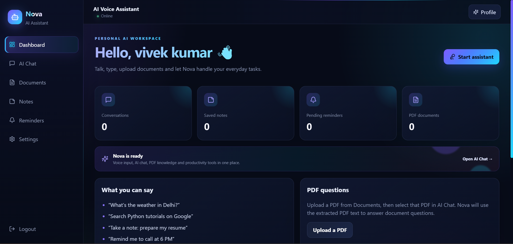
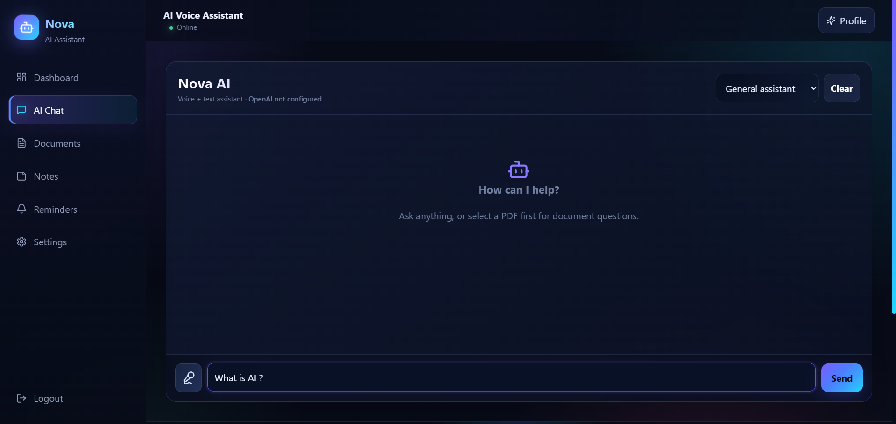
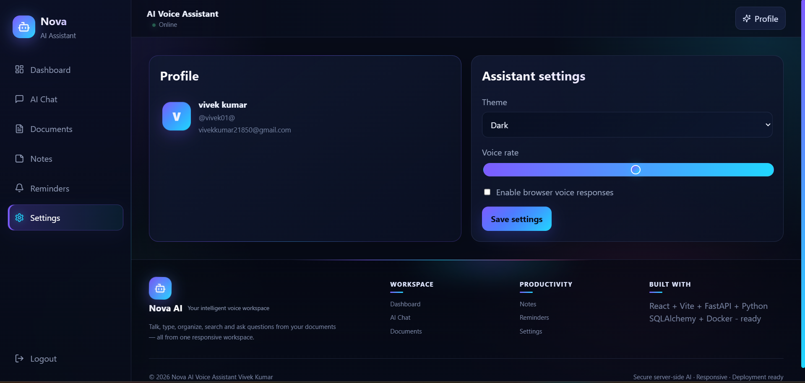

# Nova — AI Voice Assistant

A responsive full-stack AI assistant built with **React, Vite, FastAPI, and Google Gemini**. Nova combines chat and voice interaction with personal productivity tools in one web application.

## Screenshots

| Dashboard | AI Assistant |
|---|---|
|  |  |

### Settings


## Features

- AI chat powered by Google Gemini (requires an API key)
- Browser-based voice input and speech output where supported
- User registration, login, and JWT-protected pages
- PDF upload and document question answering
- Notes and reminders
- Weather and news integrations (optional API keys)
- Account and application settings
- Responsive layout for desktop, tablet, and mobile browsers
- FastAPI interactive API docs
- Docker-based deployment configuration

## Tech Stack

- **Frontend:** React, Vite
- **Backend:** Python, FastAPI
- **AI:** Google Gemini
- **Authentication:** JWT
- **Database:** SQLite, PostgreSQL
- **Deployment:** Docker, Render

## Project structure

```text
AI-Voice-Assistant-FullStack/
├── backend/
│   ├── app/
│   │   ├── core/          # Settings and security
│   │   ├── db/            # SQLAlchemy models and database
│   │   ├── routers/       # API endpoints
│   │   └── services/      # AI, email, PDF, and integrations
│   ├── .env.example       # Safe environment-variable template
│   └── requirements.txt
├── deploy/                # Nginx and container startup configuration
├── docs/images/           # README screenshots
├── frontend/
│   ├── src/               # React application and responsive styles
│   └── package.json
├── Dockerfile             # Combined frontend + backend image
├── docker-compose.yml
├── docker-compose.prod.yml
└── render.yaml
```

## Run locally on Windows

### Requirements

- Python 3.11 or 3.12 recommended
- Node.js 20 or newer
- npm

### 1. Configure backend

Open a terminal in the project root:

```powershell
cd backend
python -m venv .venv
.\.venv\Scripts\Activate.ps1
python -m pip install --upgrade pip
pip install -r requirements.txt
Copy-Item .env.example .env
```

Open `backend/.env` and add the keys you want to use. At minimum, set a strong unique `JWT_SECRET` and a valid `GEMINI_API_KEY` for AI chat. The app can start without optional weather, news, or SMTP keys, but those integrations will not work until configured.

Start the API:

```powershell
uvicorn app.main:app --reload --host 0.0.0.0 --port 8000
```

API docs: <http://localhost:8000/docs>

### 2. Start the frontend

Open a **second** terminal from the project root:

```powershell
cd frontend
npm install
npm run dev -- --host 0.0.0.0
```

Open the local Vite URL shown in the terminal, usually <http://localhost:5173>.

To test from a phone on the same Wi-Fi, find your computer's local IPv4 address with `ipconfig`, then open `http://YOUR_COMPUTER_IP:5173` on the phone. Allow the ports through Windows Firewall if prompted. The phone and computer must be on the same network. For this LAN test, create `frontend/.env` with `VITE_API_URL=http://YOUR_COMPUTER_IP:8000` before starting Vite, and set `FRONTEND_URL` in `backend/.env` to the frontend origin used by the phone. Restart both services after changing environment values.

## Environment variables

Never commit `.env` files. The repository includes `backend/.env.example` as a template. Common settings:

| Variable | Purpose |
|---|---|
| `JWT_SECRET` | Secret used to sign authentication tokens; use a long random value |
| `DATABASE_URL` | Database connection; defaults to a local SQLite file |
| `FRONTEND_URL` | Frontend origin allowed by the backend CORS policy |
| `GEMINI_API_KEY` | Google Gemini API key for AI chat |
| `GEMINI_MODEL` | Gemini model name |
| `OPENWEATHER_API_KEY` | Optional weather integration |
| `NEWS_API_KEY` | Optional news integration |
| `SMTP_HOST`, `SMTP_PORT`, `SMTP_USER`, `SMTP_PASSWORD`, `FROM_EMAIL` | Optional email/OTP/reset-email configuration |

Use provider dashboards to obtain API keys. Never place private API keys in frontend code or variables prefixed with `VITE_`; frontend variables are exposed to browsers.

## Docker

From the project root, create `backend/.env` from `backend/.env.example` and fill in your configuration.

For the separate local frontend and backend containers:

```bash
docker compose up --build
```

Open <http://localhost:5173> for the frontend and <http://localhost:8000/docs> for the API docs. Stop them with `docker compose down`.

For the combined production-style container (frontend and API on one origin):

```bash
docker compose -f docker-compose.prod.yml up --build
```

Open <http://localhost:10000>. Stop it with `docker compose -f docker-compose.prod.yml down`.

For deployment, configure secrets in the hosting provider's environment-variable settings. Do not upload local databases, `.env` files, or user uploads. For persistent production data, use a managed PostgreSQL database and set `DATABASE_URL` accordingly; ephemeral container filesystems may be reset during redeploys.

## Deploy on Render

1. Push the cleaned project to a GitHub repository.
2. In Render, create a new Blueprint and select the repository containing `render.yaml`, or create a Docker web service using the root `Dockerfile`.
3. Add environment variables in Render's dashboard. Set `GEMINI_API_KEY`, `GEMINI_MODEL`, `FRONTEND_URL`, and any optional integration keys. Set `DATABASE_URL` to your managed PostgreSQL connection string for persistent data.
4. For a single combined frontend/backend service, the frontend and API share the same domain, so `VITE_API_URL` can remain empty and API requests use relative `/api/...` URLs.
5. Deploy and verify `/api/health` and `/docs`.

**Important:** review `render.yaml` and your Render dashboard variables before deploying. Never use real secrets in the repository. Hosting configuration may need adjustments depending on whether you deploy the combined Docker image or split frontend/backend services.

## Security checklist before pushing to GitHub

- [ ] Confirm `backend/.env` and `frontend/.env` are not present in Git.
- [ ] Confirm no API keys, passwords, JWT secrets, database files, or private uploads are committed.
- [ ] If a secret was ever pushed to a public or shared repository, rotate/revoke it at the provider. Deleting the file later does not remove it from Git history.
- [ ] Set a strong `JWT_SECRET` for deployment.
- [ ] Use HTTPS and a managed database for production.

## Author

**Vivek Kumar** · [GitHub](https://github.com/vivek-kumar0)

---

Made for learning and demonstrating full-stack development.
